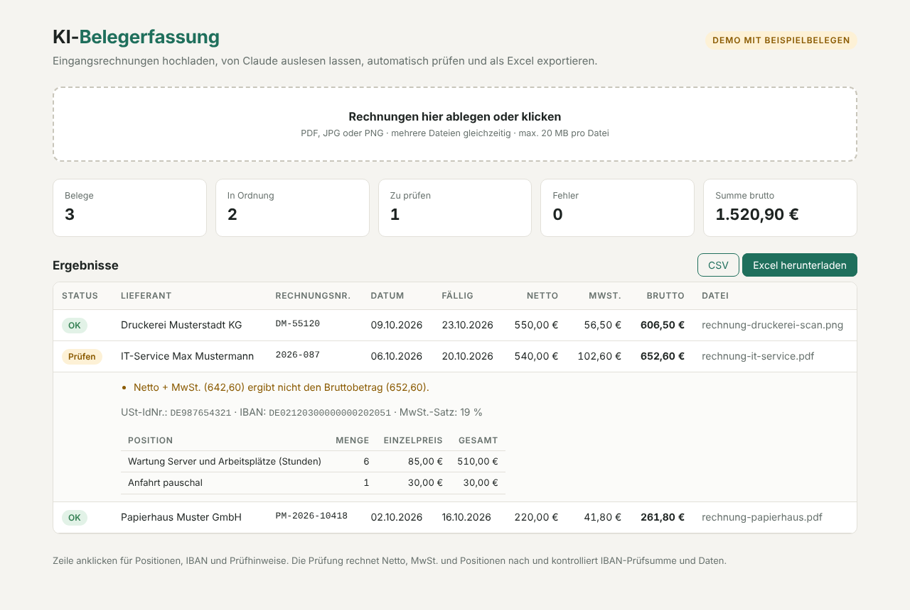

# KI-Belegerfassung

**Eingangsrechnungen mit KI auslesen, automatisch prüfen und als Excel exportieren.**

Deutsch · [English](README.en.md)




## Worum es geht

In vielen kleinen Betrieben tippt jemand Rechnungen von Lieferanten von Hand in eine Tabelle oder in die Buchhaltungssoftware: Lieferant, Rechnungsnummer, Datum, Netto, MwSt., Brutto, IBAN. Das kostet Zeit, und Tippfehler fallen oft erst bei der Zahlung auf.

Dieses Werkzeug übernimmt den ersten Schritt:

1. **Auslesen.** PDF-Rechnungen und Fotos oder Scans werden an Claude geschickt. Die Antwort kommt als strukturiertes JSON, das genau einem festen Schema entspricht (Structured Outputs), keine Freitext-Antwort.
2. **Prüfen.** Jeder Beleg wird mit normaler Rechnung kontrolliert, nicht mit KI:
   - Netto + MwSt. = Brutto
   - MwSt.-Betrag passt zum Steuersatz (0, 7 oder 19 %)
   - Summe der Positionen = Nettobetrag
   - IBAN-Prüfsumme, Format der USt-IdNr.
   - Datum nicht in der Zukunft, Fälligkeit nicht vor dem Rechnungsdatum, Fremdwährung
3. **Exportieren.** Ergebnis als Excel-Datei (farbig nach Status) und als CSV mit Semikolon und Dezimalkomma für den Import in deutsche Buchhaltungsprogramme.

Fällt eine Prüfung auf, wird der Beleg nicht verworfen, sondern als **„Prüfen“** markiert. Ein Mensch schaut ihn sich an, bevor gebucht wird.

## Schnellstart

```bash
git clone https://github.com/kunstler-dev/ki-belegerfassung
cd ki-belegerfassung
python -m venv .venv && source .venv/bin/activate     # Windows: .venv\Scripts\activate
pip install -e ".[dev]"

# Ohne API-Schlüssel: Demo mit drei Beispielrechnungen
belege web --demo                 # http://127.0.0.1:8000
belege einlesen --demo            # schreibt belege.xlsx und belege.csv

# Mit eigenem Schlüssel von console.anthropic.com
export ANTHROPIC_API_KEY=...
belege einlesen beispiele/        # oder ein eigener Ordner mit Rechnungen
belege web                        # Rechnungen im Browser hochladen
```

Im Ordner `beispiele/` liegen drei **fiktive** Rechnungen: eine korrekte PDF, eine PDF mit absichtlich falschem Bruttobetrag und ein Scan als PNG mit zwei MwSt.-Sätzen. Die Ergebnisse im Demo-Modus (`beispiele/ergebnisse.json`) sind vorbereitete Beispieldaten; ein Test stellt sicher, dass ihre Prüfhinweise genau dem entsprechen, was die Prüflogik für diese Belege liefert.

## Aufbau

```
belegerfassung/
  models.py    Schema der Rechnung (Pydantic): Lieferant, Beträge, Positionen …
  extract.py   ein API-Aufruf pro Beleg: PDF als Dokument, Bild als Bild, Antwort im Schema
  checks.py    Plausibilitätsprüfung mit Rechenregeln, unabhängig von der KI
  export.py    Excel- und CSV-Export
  cli.py       Befehle `belege einlesen` und `belege web`
  web.py       Weboberfläche (FastAPI) mit Upload, Tabelle und Export
tests/         21 Tests; der API-Client wird im Test ersetzt, es entstehen keine Kosten
```

Technische Entscheidungen:
- **Strukturierte Ausgabe statt Freitext.** `client.beta.messages.parse(..., output_format=Beleg)` liefert ein geprüftes Python-Objekt. Fehlende Angaben kommen als `null`, nicht als geratener Wert.
- **KI liest, Regeln prüfen.** Die Arithmetik macht Python, nicht das Modell. So bleibt nachvollziehbar, warum ein Beleg markiert wurde.
- **Fehler pro Beleg.** Scheitert ein Beleg (Netzwerk, unlesbare Datei), landet das im Ergebnis; der Rest des Stapels läuft weiter.
- **Fallback-Modell.** Lehnt das Modell eine Anfrage ab, wiederholt die API sie automatisch mit einem empfohlenen Ersatzmodell (`fallbacks: "default"`).
- **Kosten steuerbar.** `--effort low` (Standard) reicht für klare Belege; bei schlechten Scans hilft `medium` oder `high`.

## Meine Rolle

Ich habe dieses Projekt mit dem KI-Coding-Assistenten Claude Code umgesetzt. Ich bin kein ausgebildeter Programmierer. Mein Teil war: den Anwendungsfall aus der Praxis einer Buchhaltung auswählen, festlegen, welche Angaben ausgelesen und welche Prüfungen gemacht werden, die Umsetzung Schritt für Schritt mit der KI steuern, die Ergebnisse mit den Beispielrechnungen testen und die Dokumentation schreiben.

## Grenzen

- Kein Ersatz für die Buchhaltung: Markierte und ungewöhnliche Belege müssen von einem Menschen geprüft werden.
- Rechnungen werden zur Verarbeitung an die Anthropic API gesendet. Für echte Kundendaten vorher den Datenschutz (DSGVO, Auftragsverarbeitung) klären.
- E-Rechnungen im XRechnung- oder ZUGFeRD-Format enthalten die Daten bereits maschinenlesbar und brauchen keine KI.

## Lizenz

MIT
